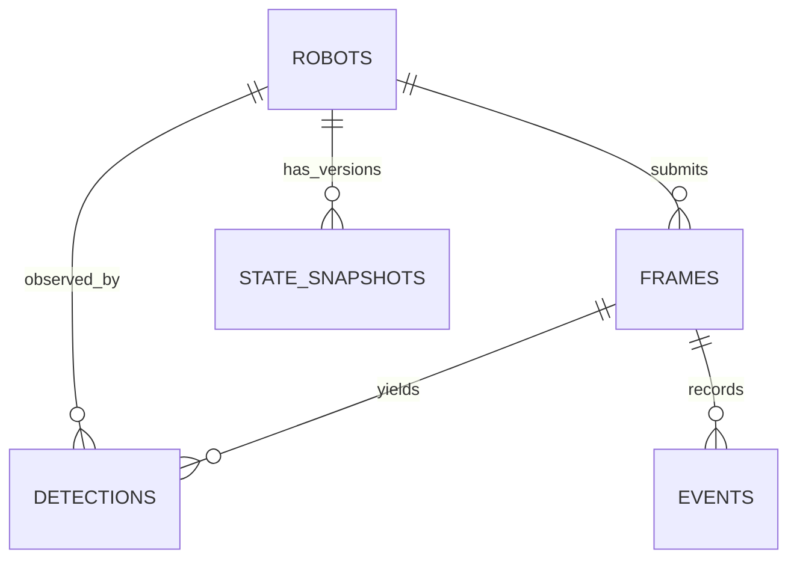

# W07 telemetry data model and ADR

**Decision:** Use SQLAlchemy Core with Alembic-managed DDL. Store structured
telemetry and completion events, discard raw images, and use indexed keyset
pagination for operator queries. SQLite is the local default. PostgreSQL uses
the same migration and models through psycopg.

## Table reference

| Table | Columns and meaning |
| --- | --- |
| robots | `id` text PK (client robot ID); `platform` text (latest by capture order); `latest_capture` UTC watermark for detecting late arrivals; `state_version` integer watermark of the most recent persisted state. |
| frames | `id` UUID string PK; `robot_id` FK; `platform` submission discriminator; `captured_at`, `received_at` UTC; integer `width`, `height`, `size_bytes`; text `format`, SHA-256 `checksum`, `job_id`, `status`; UTC `expires_at`. |
| detections | `id` UUID string PK assigned at persistence; `frame_id` FK with cascade; `robot_id` FK and `captured_at` copied from that frame in the same transaction; `class_label` text; float `confidence`, normalized top-left `x`, `y`, extents `w`, `h`; nullable integer `tracker_id`. |
| state_snapshots | Composite PK `(robot_id, version)`, robot FK, text `platform`, UTC `created_at` and `expires_at`, JSON `payload` containing the full RobotState. The frame ID in the payload is a historical reference, so a frame purge need not delete a longer-lived snapshot. |
| events | UUID string `id` PK; `frame_id` FK with cascade; `kind` text (`frame_completed` / `frame_failed`); UTC `occurred_at`; JSON `payload` (failure code when applicable, synthetic marker for seeds). |

The Week 7 starting folder had no event producer. Frame lifecycle events are
generated here; no clinical or external event ingestion is inferred. Frame
metadata is committed before enqueue; the terminal result, detections, state
snapshot and event are written in one transaction on successful completion.
A failed transaction does not publish a new encoder state. Frame detail can
fall back to durable storage. On startup, completed snapshots are restored and
robot version watermarks are reapplied. Read-triggered aging versions are
process-local, so a restart may drop such versions; completion versions remain
durable. Switching platform clears incompatible state history.

UTCDateTime rejects naive inputs and normalizes to UTC. SQLite writes UTC as
timezone-free database values and restores UTC on read; PostgreSQL uses
TIMESTAMP WITH TIME ZONE. The API separately rejects implausible capture
timestamps. Database checks reject backwards frame timestamps, invalid
confidence and geometry. Exact duplicate class/geometry within a frame is
prevented by a unique constraint; it intentionally does not approximate IoU.

## Index decision

| Index or key | Purpose and cost |
| --- | --- |
| detections `(captured_at, id)` | Ordered global pages, including time ranges; avoids sorting a growing table. |
| detections `(robot_id, captured_at, id)` | Robot pages and timeline range reads. |
| detections `(class_label, captured_at, id)` | Class pages with optional time bounds. |
| detections `(robot_id, class_label, captured_at, id)` | Both equality predicates before the time range and stable tie-breaker. |
| frames `(robot_id, captured_at)` | Robot-specific chronological frame access. |
| frames and state_snapshots `(expires_at)` | Find purge candidates without testing each live row's policy. |
| detections unique `(frame_id, class_label, x, y, w, h)`; events `(frame_id)` | Deduplication, frame lookup and efficient cascade deletion. |
| state_snapshots PK `(robot_id, version)` | Prevent duplicate versions and support ordered per-robot restore. |

B-tree ordering handles equality prefixes and ranges, with forward or
backward traversal for the two sort directions. Extra indexes increase disk,
cache and write amplification on insert and purge. Confidence stays a residual
predicate: putting a confidence inequality ahead of time would interfere with
ordered range retrieval. Index scans can still visit many entries for a very
selective confidence filter. Timeline groups after the range lookup. The
[captured query plans](W07_Query_Plans.jsonl) show the measured SQLite behavior;
PostgreSQL optimizer choices must be verified with representative deployment
data and `EXPLAIN (ANALYZE, BUFFERS)`.

## Image and retention decision

The Week 1 Fari brief described zero routine video retention for bedrooms and
care rooms, with visual processing on the robot where possible. Archiving
raw bytes or a path to a disk image would introduce a second copy of sensitive
visual data without being needed for this API. Both platforms therefore retain
**no raw image archive**. The decoded frame exists in memory for queued inference
and is closed by the worker after inference returns. Request and model buffers
are not securely erased. Metadata, detections and snapshots remain potentially
sensitive; this is not a clinical or privacy-compliance guarantee.

| Platform | Frames, detections, events | Completed snapshots | Raw images |
| --- | --- | --- | --- |
| Fari (case insensitive) | 60 s default after terminal status | 60 s default after completion | Discard |
| Default / Aido | 3600 s default after terminal status | 3600 s default after completion | Discard |

Accepted frames have an initial expiry from receipt so abandoned rows do not
live forever. If expiry is configured shorter than queue/inference duration,
a pending row can be purged before completion. Retention is evaluated by a
periodic job, so expired rows may remain visible until the next successful run.
Frame deletion cascades detections and events; snapshots have independent
expiry. Robot identifiers and watermarks are retained, and existing entity
staleness rules still apply. Client-supplied platform selection is not an
authenticated policy boundary. Deployments handling sensitive data should bind
platform to registered device identity and define retention for backups.
